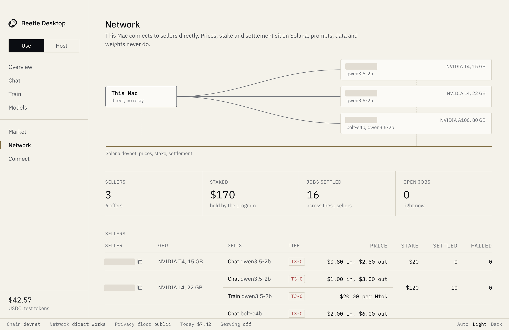

# Beetle Desktop

The desktop client for Beetle: training and inference from sellers, peer to peer, with prices and settlement on Solana.



**This repo is the client side only.** It runs on an Apple silicon Mac and holds no core logic. The wallet, payments, policy and peer-to-peer code are in [Nyctis/beetle-core](https://github.com/Nyctis/beetle-core), which is also the server side that sellers run. Beetle Desktop needs that repo's `beetle serve` on the same Mac.

```
shell/   the app: menu bar, window, serving the pages (Swift)
web/     the page: HTML, CSS and JS, no framework and no bundler
assets/  icon and menu bar mark
```

## Download

[Beetle Desktop 0.1.0](https://github.com/Nyctis/beetle-desktop/releases/tag/v0.1.0) is built for Apple silicon Macs on macOS 13 or later.

The download is the app alone, so it won't work by itself. It needs the core below on the same Mac, and to reach sellers it also needs a `chain.json` and a STUN address. Without the core, the app opens and says Beetle isn't installed.

The app is ad-hoc signed and not notarized, so macOS will block it. Unzip it, move it to Applications and clear the quarantine flag:

```bash
xattr -dr com.apple.quarantine "/Applications/Beetle Desktop.app"
```

This is the only way of opening it that has been tested.

## Install the core

You need [uv](https://docs.astral.sh/uv/). Keep the checkout out of `~/Desktop`, `~/Documents` and `~/Downloads`: macOS guards those folders and keeps asking for access.

```bash
git clone https://github.com/Nyctis/beetle-core
cd beetle-core
uv sync
mkdir -p ~/.local/bin && ln -sf "$PWD/.venv/bin/beetle" ~/.local/bin/beetle
~/.local/bin/beetle init --chain chain.json --per-job 5 --per-day 10 --min-tier public --stun HOST:PORT
```

`chain.json` and the STUN address come from whoever runs the network. For models on this Mac only, run `beetle init --local-only` instead.

## Build from source

You need the Xcode Command Line Tools.

```bash
make app
cp -R "build/Beetle Desktop.app" /Applications/
```

It finds `beetle serve` through `~/.beetle/serve.json` and starts it if nothing answers. After an update it replaces an older `beetle serve` by itself.

For work on the app, `make dev` runs it from the checkout: edit `web/`, press Command-R. `make check` snapshots the page against the real daemon.

## Which Macs

| Mac | What works |
|---|---|
| Apple silicon, macOS 14 or later | Everything, including models on this Mac |
| Apple silicon, macOS 13 | Chat and training on sellers. Nothing runs on this Mac: the last MLX for macOS 13 can't run our models |
| Intel | Nothing. `iroh` and MLX have no build for Intel Macs |

## Tested on

- **Mac:** Apple M3, 8 GB, macOS 26.6. Built with the Command Line Tools, Swift 6.3, target macOS 13.0.
- **Network:** Solana devnet with test money, against real sellers on NVIDIA T4, L4 and A100 servers.
- **Core:** its test suite passes with the normal packages and with the packages macOS 13 gets (no MLX), 514 tests each.

Not tested:

- **A real macOS 13 machine.** The macOS 13 row comes from the build target and those packages, run on a newer Mac.
- **A market with truly no sellers.** Only a market emptied by the privacy floor was tried.
- **Other ways of opening the download.** The block was measured with `spctl`. The dialog a person sees on a double-click and the Open Anyway button were not tried.
- **Running out of funds at delivery, resuming after a restart, and a real job using up an approval.** These have unit tests only.

## Results

All on synthetic data and devnet.

- **This Mac alone:** 0 of 9 training runs finished. It has 8 GB and other work was running. A quieter Mac hasn't been measured.
- **This Mac plus a seller:** 7 of 7 jobs settled, on L4 ($1.00) and A100 ($1.20), in 2 to 3 minutes each. All went 0/6 to 6/6 on the effect check. The larger model's jobs were checked on the seller, not on this Mac.
- **Every seller was T3-C:** traffic is encrypted, but the machine's owner can read the data. Nothing here claims hardware privacy. The money is test money with no value.

## What it asks of your Mac

No administrator password, no entitlements, no login item, no accessibility or screen access. The app isn't sandboxed: it starts `beetle serve`, which runs as you and can read what you can. It works in `~/.beetle`, listens on 127.0.0.1 only and keeps the Mac awake only while a job runs. It changes Claude Code or Codex settings only when you press Connect.

## License

Apache-2.0, see [LICENSE](LICENSE). The IBM Plex fonts in `web/fonts` are under the SIL Open Font License, see [OFL.txt](web/fonts/OFL.txt).
